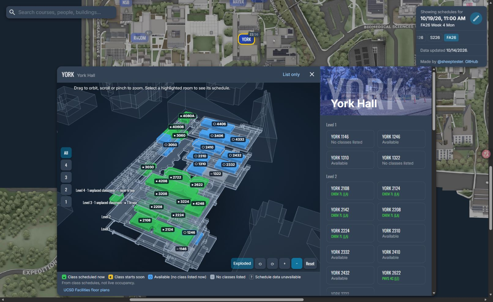

# UCSD Classroom Explorer

**English** | [简体中文](README.zh-CN.md)

Explore UC San Diego classrooms, check scheduled availability, and browse campus buildings in 3D.

**[Open the website](https://wenhaoquestion.github.io/ucsd-classrooms/)** · **[Explore YORK in 3D](https://wenhaoquestion.github.io/ucsd-classrooms/?building=YORK)** · **[Indoor geometry documentation](docs/indoor-geometry.md)**



*York Hall (YORK): explore floors and view classroom schedules for a selected date and time.*

## Features

- **Campus map:** locate buildings by name or code and view building photos.
- **Classroom schedules:** see listed classes and find gaps at a selected date and time.
- **Course and instructor search:** look up meeting locations, course times, and instructor schedules.
- **Quarter calendar:** browse academic terms, week numbers, and dates. Times use Pacific Time regardless of your browser's time zone.
- **Shareable links:** link directly to buildings, rooms, courses, instructors, and dates.
- **3D building explorer:** inspect campus building exteriors, nearby buildings, floor controls, and classroom counts. Buildings with room geometry support room selection and schedule activity colors.
- **Indoor layouts:** published Facilities data covers 77 building codes and 9,697 room records. Where plans provide only a floor listing, classrooms stay in the floor's room list instead of receiving an invented position.
- **Room-list fallback:** schedules remain accessible when 3D is disabled or WebGL is unavailable. The browser remembers your 3D preference.

## Try it

1. Open the [live website](https://wenhaoquestion.github.io/ucsd-classrooms/).
2. Select a date and time, then choose a building on the map or use search.
3. Select a room to inspect its schedule.
4. For the indoor explorer, open [YORK](https://wenhaoquestion.github.io/ucsd-classrooms/?building=YORK). Try a mapped room such as [2622](https://wenhaoquestion.github.io/ucsd-classrooms/?building=YORK&room=2622).

## Run locally

Requires **Node.js 22** and npm. Commands work on Windows, macOS, and Linux.

```sh
git clone https://github.com/wenhaoquestion/ucsd-classrooms.git
cd ucsd-classrooms
npm ci
npm run dev
```

Open **http://localhost:8000/**. Building photos are hosted on Imgur, so use `localhost` if images do not load on `127.0.0.1`.

```sh
# Create the production site in dist/
npm run build

# Run the same checks used before deployment
npm run typecheck
npm run lint -- src scripts tests
npm test
npm run validate:indoor

# Rebuild the EBU3B runtime layout from its source data
npm run indoor:build -- EBU3B

# Convert downloaded public campus-map layers into exterior geometry
npm run campus:build -- footprints.json attributes.json
```

## Deploy to GitHub Pages

The site is a static frontend; no application server or API key is required. It loads classroom schedules and building photos from external public sources.

The [deployment workflow](.github/workflows/gh-pages.yml) runs on pushes to `main` and can also be started manually from the repository's Actions tab. It installs locked dependencies, runs validation, builds `dist/`, and publishes that directory to GitHub Pages.

In **Settings → Pages → Build and deployment**, use **GitHub Actions** as the source. Once deployment succeeds, the site is available at:

**https://wenhaoquestion.github.io/ucsd-classrooms/**

When deploying a different fork, update the site URL in `scripts/build.mjs`, the preview image URL in `static/index.html`, and the repository links in both READMEs, `package.json`, and `src/components/App.tsx`.

## Project structure

| Path | Purpose |
| --- | --- |
| `src/components/` | React application, schedules, search, and explorer UI |
| `src/explorer3d/` | Three.js renderer, indoor scenes, and particles |
| `src/lib/indoor/` | Layout schema, loading, geometry validation, and schedule mapping |
| `data/indoor/EBU3B/` | Source metadata, room labels, and traced floor geometry |
| `static/indoor/` | Runtime layouts fetched when a mapped building opens |
| `static/indoor/facilities/` | Published Facilities layouts and their building index |
| `static/campus/` | Public campus-map footprints and ground/roof elevations |
| `scripts/` | Cross-platform build and indoor-data tooling |
| `tools/indoor-trace/` | Python helpers for tracing public floor maps |
| `tests/` | Indoor geometry, room status, and navigation tests |
| `docs/indoor-geometry.md` | Sources, accuracy limits, schema, and mapping workflow |

The frontend uses **React 19, TypeScript, Three.js, and esbuild**. The 3D scene is loaded on demand so the initial page does not need to download Three.js.

## Data and coverage

- **Schedules:** fetched from [SheepTester's public classroom data](https://sheeptester.github.io/uxdy/data/) by academic term. This repository does not run the schedule scraper. The interface displays data refresh information; availability reflects listed classes, not live occupancy or room reservations.
- **Campus exteriors:** public campus-map data supplies 585 footprint parts and matches 93 registrar building codes. Exterior-only views estimate floor counts and group classrooms by their room numbers; they do not invent room positions. TASB currently has no matching footprint.
- **Published indoor coverage:** 77 Facilities layouts are included in the repository and production build, with 9,697 room records. Data loads only when a building opens. Facilities layouts take priority over the original EBU3B trace, matching the completed preview; the original 300-room CSE trace remains available in the source data.
- **Geometry:** Facilities room outlines are converted from floor plans, scaled from listed room areas, and fitted to campus footprints. Some rooms have only a floor assignment. Vertical spacing and estimated heights are illustrative; these are not surveyed building models. Source references and conversion notes remain attached to each layout.

See [Indoor geometry and the 3D building explorer](docs/indoor-geometry.md) for source links, known gaps, and instructions for adding another building. The optional tracing helpers require Python 3, Pillow, NumPy, and SciPy; running the website does not.

## Credits and license

This project extends [SheepTester/ucsd-classrooms](https://github.com/SheepTester/ucsd-classrooms), originally created by Sean (SheepTester). Earlier history is in [SheepTester/uxdy/classrooms](https://github.com/SheepTester/uxdy/tree/main/classrooms). This fork adds the building explorer, campus exteriors, Facilities layouts, traced EBU3B data, supporting tools, tests, and deployment updates.

The campus map was prepared with [SheepTester's UCSD map tool](https://sheeptester.github.io/words-go-here/misc/ucsd-map.html). Indoor source plans are credited in the [geometry documentation](docs/indoor-geometry.md).

Code is distributed under the [MIT License](LICENSE), retaining the original copyright notice. External maps, photos, and datasets remain attributed to their respective sources.
